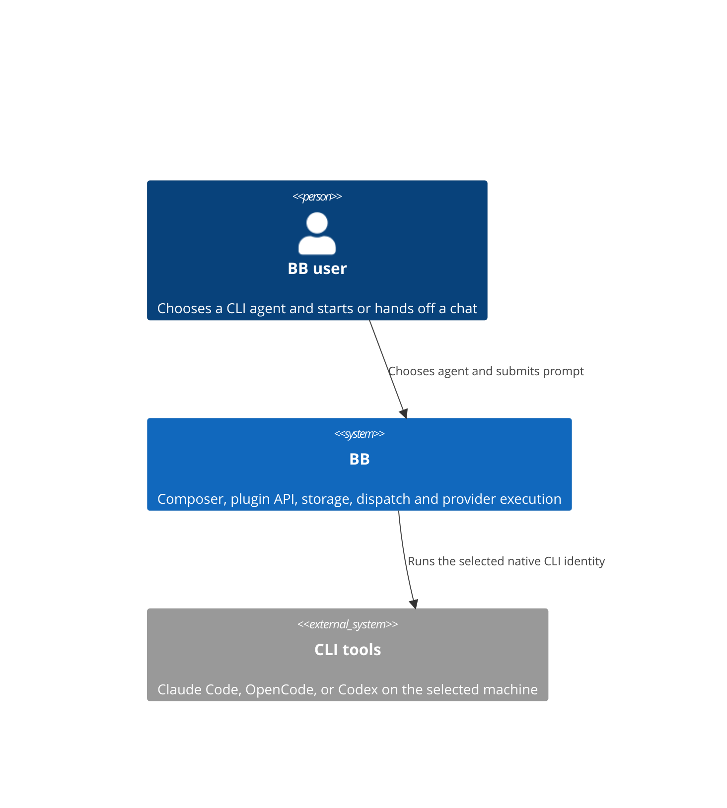
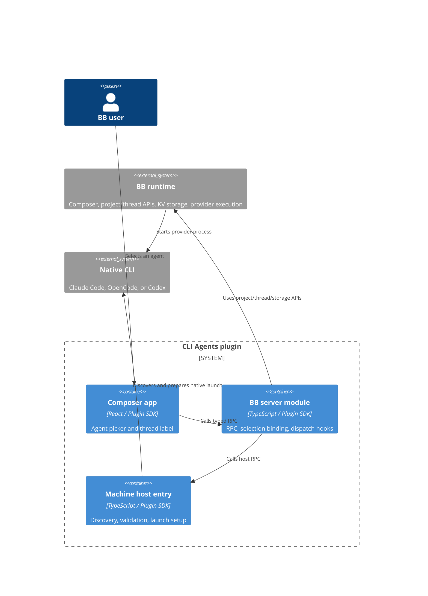
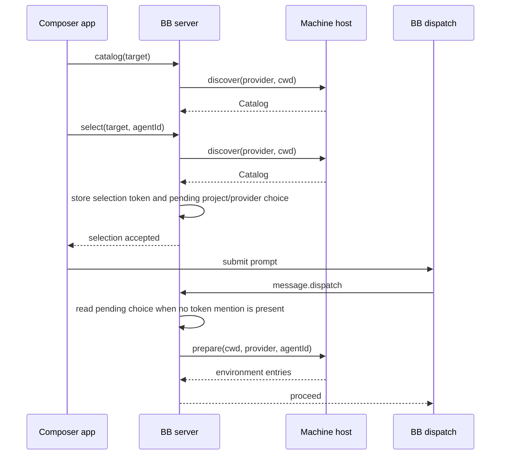
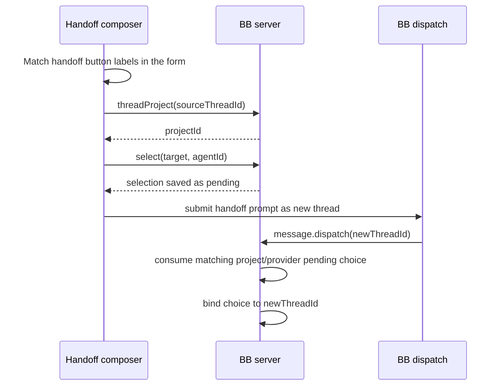

# CLI Agents architecture

TL;DR: The BB app selects an agent, the BB server stores and validates selection state, and the BB host discovers the local CLI agent and returns native launch settings.

## System Context

BB owns the composer and dispatch hooks, while CLI Agents declares separate server, app, and host entry files (`package.json:9-20`).

## Containers

`hostContract` defines server-to-host methods (`contract.ts:36-53`); `rpcContract` defines app-to-server methods (`contract.ts:54-98`). The host entry binds discovery, instructions, and preparation to adapter functions (`host.ts:6-29`).

## RPC contract

`rpcContract` is registered by the BB server; its Zod schemas validate each method's input and output (`contract.ts:54-98`, `server.ts:110-140`). The app calls these methods through the typed plugin RPC client. They are plugin RPC methods, not HTTP routes (`app.tsx:26`, `server.ts:110-140`).

| Method | Inputs and server steps | Success output | Conditions and failures |
| --- | --- | --- | --- |
| `defaults` | Takes `projectId`; reads the project and its default execution options (`contract.ts:55-58`, `server.ts:111-122`). | `{hostId, providerId}`; host is the default project source or first source, and provider is the project default or empty string (`server.ts:117-121`). | Project SDK errors propagate. An empty project source list produces an empty `hostId` (`server.ts:117-120`). |
| `catalog` | Takes a validated `Target`; resolves its path and invokes host `discover` (`contract.ts:59`, `server.ts:66-71`, `server.ts:123`). | `Catalog` (`contract.ts:12-17`). | Offline host, invalid/mismatched environment, missing project checkout, and host discovery errors reject the call (`server.ts:38-60`, `server.ts:66-71`). |
| `select` | Takes a target and 1–200 character `agentId`; resolves the path and rediscovers before storing selection and pending records (`contract.ts:60-63`, `server.ts:73-91`, `server.ts:124`). | `{token, label}` (`contract.ts:60-63`, `server.ts:91`). | Unsupported catalogs or absent IDs throw `Agent is not available. Refresh the list.` Target, host, or storage errors propagate (`server.ts:38-60`, `server.ts:73-91`). |
| `pending` / `clearPending` | Use `projectId` and a supported `providerId` to read or delete that pending key (`contract.ts:64-77`, `server.ts:93-101`, `server.ts:125-127`). | `Selection \| null` for `pending`; `true` for `clearPending` (`contract.ts:69`, `contract.ts:76`). | Missing values return `null`; invalid stored selection data or storage errors reject the call (`server.ts:97-101`). |
| `thread` / `threadProject` | Take `threadId`; `thread` reads and validates the stored binding, while `threadProject` reads the BB thread (`contract.ts:78-85`, `server.ts:62-65`, `server.ts:128-132`). | `Selection \| null`; or `{projectId}` (`contract.ts:78-85`). | Missing binding returns `null`; malformed stored bindings and BB thread lookup errors reject (`server.ts:62-65`, `server.ts:129-132`). |
| `favorites` / `favorite` | Read IDs by provider; mutation removes an existing ID, optionally appends it, and keeps the last 200 (`contract.ts:86-97`, `server.ts:103-108`, `server.ts:133-138`). | Up to 200 agent ID strings (`contract.ts:86-97`). | Read filters non-string values and slices to 200; storage errors reject (`server.ts:103-108`, `server.ts:133-138`). |

## Building Blocks

- [Composer app and selection UI](overview.md) — registers the picker for new-thread and thread scopes, with handoff detection (`app.tsx:495-510`).
- [Adapter discovery and host contract](ADAPTERS.md) — provider-specific metadata discovery and process configuration (`adapters/discovery.ts:240-282`, `host.ts:6-29`).
- BB server module — owns pending selections, durable selection records, thread bindings, CLI commands, and dispatch validation (`server.ts:73-140`, `server.ts:157-239`, `server.ts:250-293`).
- [Stored selection data](data-model.md) — key-value record families and their lifecycle (`server.ts:29-32`, `server.ts:63-108`, `server.ts:227-248`).

## Key Flows

### Choose and bind an agent

The app calls `select`, which resolves the target checkout, verifies the identity by host discovery, and stores token and pending records. The composer submits a normal prompt; dispatch reads pending project/provider state when no token mention is present, then stores thread and environment records (`app.tsx:224-254`, `server.ts:38-60`, `server.ts:73-101`, `server.ts:157-232`). The CLI `select` command also returns a marker for a new-chat prompt (`server.ts:250-293`).

### Handoff composer

The public composer scope remains `thread`; `isHandoffComposer` recognizes English and Russian handoff labels, and draft keys separate handoff text from new-thread text (`lib/handoff-mode.ts:1-33`, `lib/draft-selection.ts:21-51`). The app resolves the source thread's project and maintains pending selection through the new thread dispatch (`app.tsx:23-38`, `app.tsx:60-74`, `server.ts:182-232`).

## Invariants

- At most one selection token is accepted from a submitted message; more than one rejects dispatch (`server.ts:167-170`).
- A chat's selected identity cannot be replaced by a different token once bound (`server.ts:170-181`).
- Dispatch checks the requested provider, project, and host before preparing the selected identity (`server.ts:160-203`).
- A selection can follow the chat into another folder of the same project; the host rechecks that the agent exists there (`server.ts:205-219`, `host.ts:12-17`).
- Codex stores selected instructions per thread and exposes them through BB's instruction contribution callback (`server.ts:28-36`, `server.ts:221-228`).

## Cross-cutting concerns

**Validation.** Zod schemas constrain provider IDs, catalog sizes, selection fields, and host/RPC inputs and outputs (`contract.ts:3-53`).

**Failures.** Dispatch catches selection, target, discovery, and preparation errors and returns a reject action with a `CLI Agents` prefix (`server.ts:233-238`).

**Machine boundary.** The server calls the typed host client with the selected `hostId`; the host executes discovery and launcher preparation on that machine (`server.ts:37-71`, `host.ts:6-27`).

<!-- lane-pilot:backlinks -->
## Referenced by

- [CLI Agents overview](overview.md)
