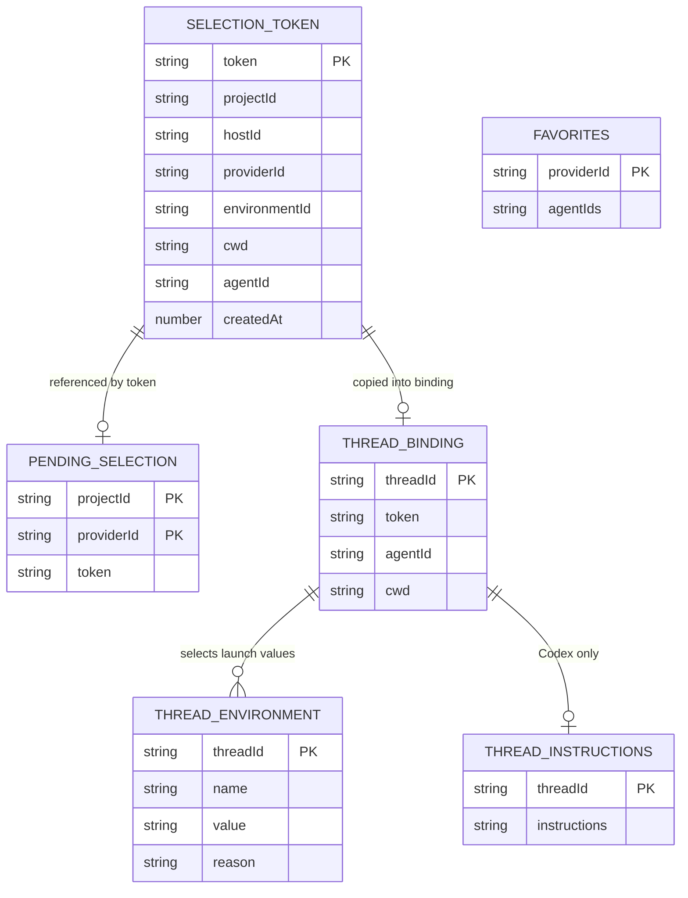

# CLI Agents data model

TL;DR: CLI Agents defines no relational database tables; it stores selections, thread bindings, launch environment, Codex instructions, and favorites as BB key-value records.

## Schema overview

The diagram shows record families and their key relationships; `PK` marks the suffix or value that identifies a record in BB KV storage.

Record schemas and key construction are in the server's KV accessors and the `Selection` and `envSchema` contracts (`server.ts:63-108`, `server.ts:227-248`, `contract.ts:19-35`).

## Records

### Selection token — `selection:<uuid>`

Purpose: preserve the structured mention's selection payload for message resolution (`server.ts:82-91`, `server.ts:141-155`).

| Field | Meaning |
| --- | --- |
| `projectId` | BB project chosen in the composer. |
| `hostId` | Machine where the CLI agent was discovered. |
| `providerId` | One of `claude-code`, `acp-opencode`, or `codex`. |
| `environmentId` | Selected BB environment ID, or `null` for project checkout. |
| `agentId` | Provider-native agent or profile identity. |
| `cwd` | Absolute working directory resolved when selected; dispatch can replace it with the actual chat environment path. |
| `token` | UUID attached to the selection mention. |
| `createdAt` | Unix epoch timestamp in milliseconds from `Date.now()`. |

The runtime validator and allowed providers are defined in `contract.ts:3-31`; dispatch's folder rebinding is in `server.ts:205-219`.

### Pending selection — `pending:<projectId>:<providerId>`

Purpose: hold the most recently selected identity for the next matching new-chat dispatch without requiring a mention token in the submitted text (`server.ts:89-101`, `server.ts:182-193`). The value is a full Selection record.

| Field | Meaning |
| --- | --- |
| `projectId` | Project scope in the key and stored selection. |
| `providerId` | CLI scope in the key and stored selection. |
| Value | Selection record, including machine, environment, working directory, agent ID, token, and creation timestamp (`contract.ts:19-31`). |

### Thread binding — `thread:<threadId>`

Purpose: keep the chosen identity attached to a chat across later turns and plugin reloads (`server.ts:62-65`, `server.ts:227-232`). The value is a full Selection record.

| Field | Meaning |
| --- | --- |
| `threadId` | BB thread ID in the key. |
| Value | Selection record; `cwd` may be changed to the actual thread environment before storage (`server.ts:205-211`, `server.ts:230`). |

### Thread environment — `env:<threadId>`

Purpose: persist host-returned process environment entries for supported environment-contributing providers (`server.ts:227-248`).

| Field | Meaning |
| --- | --- |
| `threadId` | BB thread ID in the key. |
| `name` | Environment variable name, such as `BB_CLAUDE_CODE_EXECUTABLE` or `PATH` (`adapters/launch.ts:29-60`). |
| `value` | Variable value returned by host preparation. |
| `reason` | Human-readable reason attached to the environment entry (`contract.ts:33-35`). |

### Thread instructions — `instructions:<threadId>`

Purpose: persist Codex profile instructions so BB can contribute them again after plugin reload (`server.ts:28-36`, `server.ts:221-228`).

| Field | Meaning |
| --- | --- |
| `threadId` | BB thread ID in the key. |
| Value | `developer_instructions` string, required to be non-empty and at most 4096 characters (`adapters/codex.ts:81-92`). |

### Favorites — `favorites:<providerId>`

Purpose: retain starred agent IDs per provider (`server.ts:103-108`, `server.ts:133-138`).

| Field | Meaning |
| --- | --- |
| `providerId` | CLI provider whose picker list uses the saved favorites. |
| Value | Ordered string array, filtered to strings and capped at 200 on read; pinning also retains the most recent 200 (`server.ts:103-108`, `server.ts:133-138`). |

## Selection lifecycle

| From | To | Function and location | When |
| --- | --- | --- | --- |
| No pending value | Pending selection | `select` (`server.ts:73-91`) | After host rediscovery confirms the chosen ID; writes both token and project/provider pending records. |
| Pending selection | Consumed | `message.dispatch` (`server.ts:182-191`) | A dispatch has no mention-bound selection and the pending record matches the dispatch host; the pending key is deleted. |
| Pending selection | Pending selection | `message.dispatch` (`server.ts:182-191`) | The pending selection belongs to another host; it is not consumed. |
| Pending selection | Removed | `clearPending` (`server.ts:93-101`, `server.ts:125-127`) | The picker invokes `clearPending` for the target project and provider. |
| Selected | Thread binding | `message.dispatch` (`server.ts:227-232`) | Host preparation succeeds; the selected record and environment entries are stored by thread ID. |

None of these records has a status field. The selection-token record has no delete call in the plugin server; the source defines no TTL or cleanup job for these KV prefixes (`server.ts:73-101`, `server.ts:141-155`, `server.ts:227-248`).

## Invariants and use cases

- Selection, pending, thread-binding, environment, instruction, and favorite records are written and read by the BB server (`server.ts:73-108`, `server.ts:227-248`).
- Pending selection is scoped by project and provider. Dispatch also checks the selected host before consuming it (`server.ts:89-101`, `server.ts:182-191`).
- A binding stores the selection per thread; dispatch rejects replacing an existing binding with a different token (`server.ts:170-181`, `server.ts:227-232`).
- Codex instructions are loaded from all `instructions:` keys during server startup and only strings up to 4096 characters enter the in-memory contribution map (`server.ts:28-36`).
- The server source defines no retention or cleanup job for these prefixes; favorites are bounded to 200 IDs at read and write (`server.ts:103-108`, `server.ts:133-138`).

<!-- lane-pilot:backlinks -->
## Referenced by

- [CLI Agents architecture](architecture.md)
- [CLI Agents overview](overview.md)
